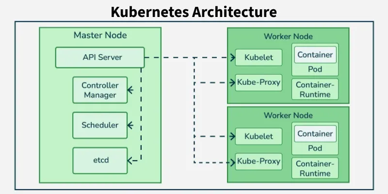
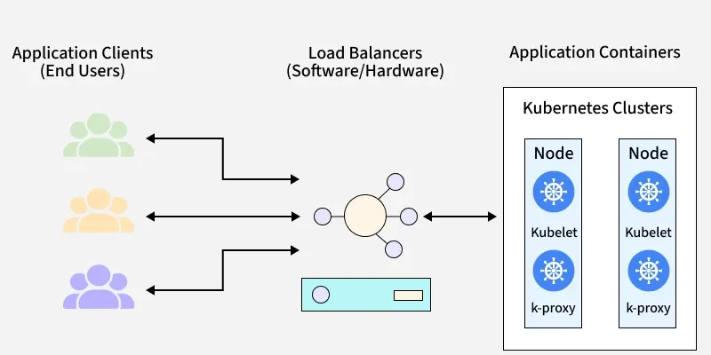
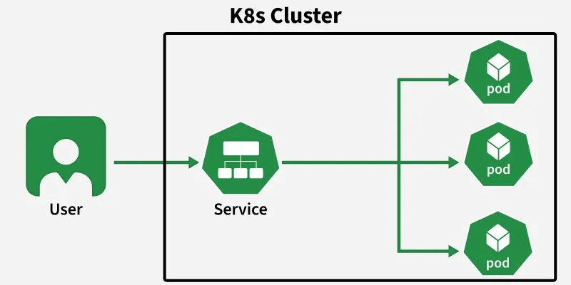

# Kubernetes Tutorial

**Last Updated:** 25 Jun 2026

Kubernetes is an open-source container management platform.

- Automates the deployment, management, and scaling of container-based applications.
- Developed at Google in 2014 and now maintained by the Cloud Native Computing Foundation (CNCF).
- Orchestrates containers by grouping them into logical units called Pods.
- Manages container lifecycle across a cluster of machines.
- Automatically restarts failed containers and reschedules workloads onto healthy nodes.

## Basics of Kubernetes

Kubernetes is like a ship captain for containers, organizing and placing them on multiple computers. Understanding Kubernetes starts with core concepts such as Pods, Services, and Deployments.

### Core Concepts

- [Introduction to Kubernetes](https://www.geeksforgeeks.org/devops/introduction-to-kubernetes-k8s/)
- [Architecture](https://www.geeksforgeeks.org/devops/kubernetes-architecture/)
- [Installation Methods](https://www.geeksforgeeks.org/devops/install-kubernetes-on-ubuntu/)
- [Installation of Kubernetes on Ubuntu](https://www.geeksforgeeks.org/installation-guide/how-to-install-and-configure-kubernetes-on-ubuntu/)

### Objects

- [Concept of Containers](https://www.geeksforgeeks.org/cloud-computing/kubernetes-concept-of-containers/)
- [Introduction to Container Orchestration](https://www.geeksforgeeks.org/devops/introduction-to-kubernetes-k8s/)
- [Images](https://www.geeksforgeeks.org/devops/kubernetes-images/)
- [Jobs](https://www.geeksforgeeks.org/devops/kubernetes-jobs/)
- [Labels & Selectors](https://www.geeksforgeeks.org/devops/kubernetes-labels-selectors/)
- [Pod](https://www.geeksforgeeks.org/devops/kubernetes-pods/)
- [Namespace](https://www.geeksforgeeks.org/devops/kubernetes-namespaces/)
- [Node](https://www.geeksforgeeks.org/devops/kubernetes-node/)
- [Run a Command in Pod Containers](https://www.geeksforgeeks.org/devops/kubernetes-run-a-command-in-pods-containers/)
- [Create Multiple Containers in a Pod](https://www.geeksforgeeks.org/devops/kubernetes-creating-multiple-container-in-a-pod/)
- [Replication Controller](https://www.geeksforgeeks.org/devops/kubernetes-replication-controller/)
- [Difference Between ReplicaSet and Replication Controller](https://www.geeksforgeeks.org/devops/kuberneters-difference-between-replicaset-and-replication-controller/)
- [Deployments](https://www.geeksforgeeks.org/devops/kubernetes-deployment/)
- [ReplicaSet](https://www.geeksforgeeks.org/devops/kubernetes-creating-a-replicaset/)

### Scheduling

- [Manual Scheduling](https://www.geeksforgeeks.org/devops/manual-scheduling-in-kubernetes/)
- [Taints and Tolerations](https://www.geeksforgeeks.org/devops/how-to-use-kubernetes-taints-and-tolerations/)
- [Node Affinity](https://www.geeksforgeeks.org/devops/node-affinity-in-kubernetes/)

### Services & Networking

- [NodePort Service](https://www.geeksforgeeks.org/devops/kubernetes-nodeport-service/)
- [ClusterIP vs NodePort](https://www.geeksforgeeks.org/devops/kubernetes-cluster-ip-vs-node-port/)
- [Service](https://www.geeksforgeeks.org/devops/kubernetes-services/)
- [Service DNS](https://www.geeksforgeeks.org/devops/kubernetes-service-dns/)
- [Network Policies](https://www.geeksforgeeks.org/devops/how-to-use-kubernetes-network-policies/)

### Storage & Security

- [Volumes](https://www.geeksforgeeks.org/devops/kubernetes-volumes/)
- [Secrets](https://www.geeksforgeeks.org/devops/kubernetes-secrets/)
- [Working with Secrets](https://www.geeksforgeeks.org/devops/kubernetes-working-with-secrets/)
- [Set Up a Kubernetes Cluster on a Local Machine Using Minikube](https://www.geeksforgeeks.org/node-js/how-to-set-up-kubernetes-cluster-on-local-machine-using-minikube/)
- [Physical Servers vs Virtual Machines vs Containers](https://www.geeksforgeeks.org/devops/kubernetes-physical-servers-vs-virtual-machines-vs-containers/)

### Working with Kubectl

- [Kubectl](https://www.geeksforgeeks.org/devops/kubernetes-kubectl/)
- [Kubectl Commands](https://www.geeksforgeeks.org/devops/kubernetes-kubectl-commands/)
- [Kubectl Delete](https://www.geeksforgeeks.org/devops/kubernetes-kubectl-delete/)
- [Kubectl Create and Kubectl Apply](https://www.geeksforgeeks.org/devops/kubernetes-kubectl-create-and-kubectl-apply/)

### Load Balancing & Configuration

- [Load Balancing Service](https://www.geeksforgeeks.org/devops/kubernetes-load-balancing-service/)
- [ConfigMap](https://www.geeksforgeeks.org/devops/kubernetes-configmap/)
- [Create ConfigMap From Files](https://www.geeksforgeeks.org/cloud-computing/kubernetes-create-config-map-from-files/)
- [Create ConfigMap from YAML](https://www.geeksforgeeks.org/devops/kubernetes-create-configmap-from-yaml-file/)
- [ConfigMap from Directories](https://www.geeksforgeeks.org/devops/kubernetes-config-map-from-directory/)
- [Injecting ConfigMap as Files](https://www.geeksforgeeks.org/devops/kubernetes-injecting-configmap-as-files/)
- [Injecting ConfigMap in Pods](https://www.geeksforgeeks.org/devops/kubernetes-injecting-configmap-in-pods/)
- [Kubernetes Resource Model (KRM) and YAML](https://www.geeksforgeeks.org/linux-unix/kubernetes-resource-model-krm-and-how-to-make-use-of-yaml/)

## Advanced Kubernetes

This section covers advanced techniques for operating and managing production Kubernetes environments.

- [API](https://www.geeksforgeeks.org/devops/kubernetes-api/)
- [Deployment Strategies](https://www.geeksforgeeks.org/devops/what-are-the-kubernetes-deployment-stratagies/)
- [Static Pods](https://www.geeksforgeeks.org/devops/careate-static-pod-in-kubernetes/)
- [Container Patterns](https://www.geeksforgeeks.org/devops/kubernetes-sidecar-container-logging/)
- [Liveness and Readiness Probes](https://www.geeksforgeeks.org/devops/how-to-use-kubernetes-liveness-and-readiness-probes/)
- [StatefulSets](https://www.geeksforgeeks.org/devops/how-to-use-kubernetes-statefulsets/)
- [Resource Quotas](https://www.geeksforgeeks.org/devops/managing-cpu-and-memory-resources-in-kubernetes/)

## Real-World Use Cases & Projects

- [Deploying Applications Using Kubernetes](https://www.geeksforgeeks.org/devops/deploying-application-using-kubernetes-full-project-tutorial/)
- [Installing Private Git Server on K8s Cluster with Gitea and AKS](https://www.geeksforgeeks.org/git/installing-private-git-server-on-k8s-cluster-with-gitea-and-aks/)
- [Enable Remote Debugging for Java 